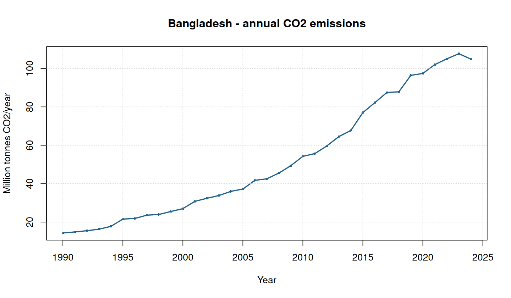
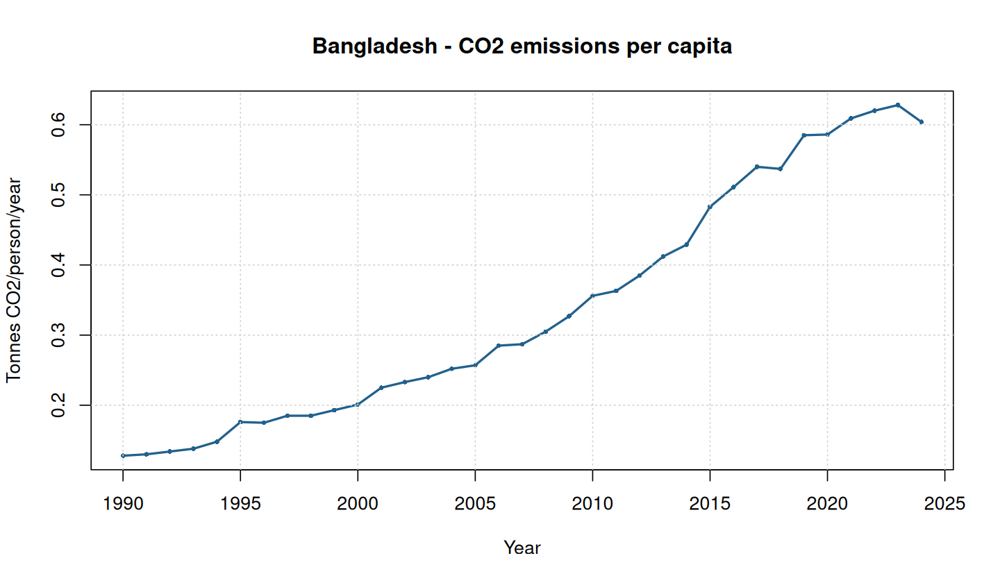
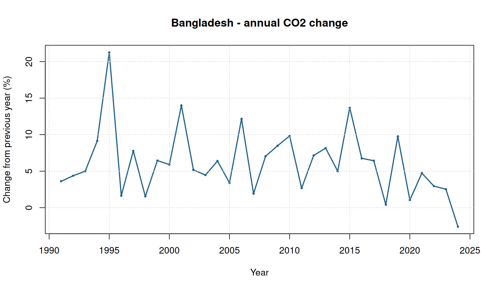

# co2-emissions-BGD
Country-level CO2 emissions analysis
# Bangladesh CO₂ Emissions Analysis (1990–2024)

Country: Bangladesh  
ISO-3 Code: BGD  
Study Period: 1990–2024

Introduction

This project examines the changes in Bangladesh's carbon dioxide (CO₂) emissions from 1990 to 2024. It focuses on annual CO₂ emissions, CO₂ emissions per capita, and year-to-year percentage changes. The analysis was conducted using RStudio and the Our World in Data (OWID) CO₂ dataset.

Data Source

- Primary source: [Our World in Data – CO₂ and Greenhouse Gas Emissions](https://github.com/owid/co2-data)
- Independent reference: [World Bank – CO₂ Emissions Data for Bangladesh](https://data.worldbank.org/indicator/EN.GHG.CO2.ZG.AR5?locations=BD)

The analysis uses the country-specific data for Bangladesh (BGD), covering 1990–2024.

Methods

The analysis was performed using base R functions in RStudio.

1. Downloaded and imported the OWID CO₂ dataset.
2. Filtered the dataset using Bangladesh's ISO-3 code (BGD).
3. Selected annual CO₂ emissions and CO₂ emissions per capita.
4. Calculated year-to-year percentage changes in annual emissions.
5. Generated three graphs and two CSV result tables.
6. Saved the R session information for documentation and reproducibility.

Results and Figures

1. Annual CO₂ Emissions

2. CO₂ Emissions Per Capita

3. Annual Percentage Change

Interpretation of Results

The analysis shows an overall increase in Bangladesh's annual CO₂ emissions between 1990 and 2024. In 1990, emissions were approximately 14.328 million tonnes of CO₂. By 2024, this value had increased to 104.903 million tonnes, representing an increase of approximately 632.15% from the starting year. The highest recorded annual emissions within the study period occurred in 2023, reaching 107.707 million tonnes.

The results indicate that Bangladesh's CO₂ emissions generally increased over the 34-year period, although changes were not necessarily consistent every year. The slight decrease from the 2023 peak to 104.903 million tonnes in 2024 shows that annual emissions can fluctuate rather than increase continuously.

CO₂ emissions per capita provide another perspective because they account for the country's population. The latest recorded value in the dataset was approximately 0.604 tonnes per person in 2024. This measure helps distinguish total national emissions from the average emissions associated with each person.

Overall, the findings suggest that Bangladesh experienced substantial growth in annual CO₂ emissions from 1990 to 2024. Population growth, increasing energy demand, industrial development, and changes in economic activities may be relevant factors to investigate further. However, this analysis identifies trends and does not establish the causes of those changes.

Limitations

- The analysis is limited to the variables available in the OWID dataset.
- Missing observations may affect comparisons between years.
- Annual changes describe trends but do not establish their causes.
- CO₂ emissions per capita represent an average and do not describe differences among individuals.
- Other greenhouse gases and land-use emissions are not included in this CO₂-only analysis.

Conclusion

Bangladesh's annual CO₂ emissions increased substantially between 1990 and 2024, with the highest value recorded in 2023. The graphs and statistical summaries provide an overview of the country's emissions trend and changes over time. Further research incorporating energy consumption, population growth, and industrial activities could help explain the observed patterns.

Files Included

- `data/BGD_co2.csv` – Bangladesh-specific dataset
- `figures/` – Three generated graphs
- `results/BGD_summary.csv` – Summary statistics
- `results/BGD_yearly_changes.csv` – Annual emissions and percentage changes
- `results/session_info.txt` – R session information
- `scripts/analyze_co2.R` – R analysis script

References

1. Our World in Data. (n.d.). [CO₂ and Greenhouse Gas Emissions Dataset](https://github.com/owid/co2-data).
2. World Bank. (n.d.). [Carbon dioxide (CO₂) emissions – Bangladesh](https://data.worldbank.org/indicator/EN.GHG.CO2.ZG.AR5?locations=BD).
